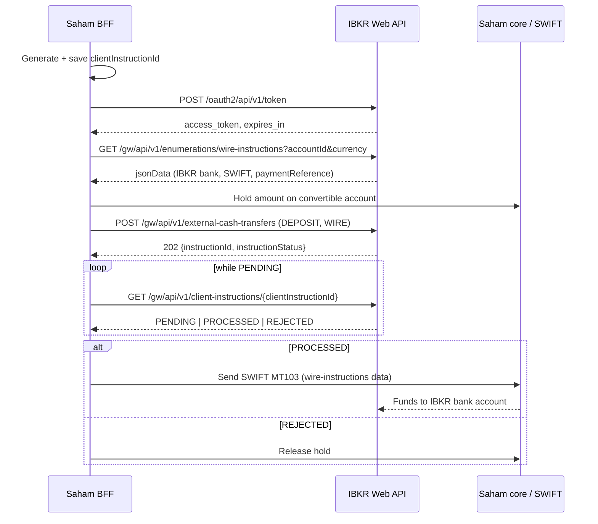

# IBKR Wire Deposit — Flow, DB Schema & Open Questions

Nov 26, 2026 · @Zed

## 1. Deposit sequence diagram

Saham sends the real SWIFT only after IBKR returns PROCESSED on the deposit notification; on REJECTED, the hold is released and no money leaves.



| Status from IBKR | What the BFF does |
| --- | --- |
| PROCESSED | Send the SWIFT |
| PENDING | Keep the hold, keep polling, send nothing |
| REJECTED | Release the hold, show the error, send nothing |
| Timeout / 5xx | Call `client-instructions/{id}` before retrying |

Waiting for PROCESSED before sending the wire is our design choice, not an explicit IBKR rule; it is question 7 below. `clientInstructionId` is generated by our server (DB sequence), saved before the call, never reused.

## 2. Requests and responses

Four calls make a deposit: token, wire instructions, deposit notification, status poll. Shapes and field names come from the IBKR docs and the OpenAPI spec (`api.ibkr.com/gw/api/v3/api-docs`); IDs, amounts and dates are illustrative. Body signing is still open (IBKR question 1), so headers show only what the spec states.

### Step 1 — Get an access token

```http
POST https://api.ibkr.com/oauth2/api/v1/token
Content-Type: application/x-www-form-urlencoded

grant_type=client_credentials
&client_assertion_type={{clientAssertionType}}
&client_assertion={{clientAssertion}}
&scope=transfers.write instructions.read enumerations.read
```

Response `200`:

```json
{
  "access_token": "<JWT>",
  "token_type": "Bearer",
  "scope": "transfers.write instructions.read enumerations.read",
  "expires_in": 86399
}
```

Cache the token until `expires_in` (about 24 h in the spec example). Error `400`: `{"type":"/simple","title":"Bad Request","status":400}`.

### Step 2 — Get IBKR's wire instructions

```http
GET /gw/api/v1/enumerations/wire-instructions?accountId=U1234567&currency=USD
Authorization: Bearer <access_token>
```

Response `200`:

```json
{
  "enumerationsType": "wire-instructions",
  "jsonData": [
    {
      "currency": "USD",
      "accountNameAndBeneficiary": "<from IBKR>",
      "accountNumber": "<from IBKR>",
      "routingNumber": "<from IBKR>",
      "bankSWIFTCode": "<from IBKR>",
      "bankTitleAndAddress": "<from IBKR>",
      "alternateAccountInfo": "<from IBKR>",
      "paymentReference": "<from IBKR>"
    }
  ]
}
```

The spec leaves `jsonData` untyped; these field names come from the docs page. This is where Saham sends the real SWIFT. Call it before every deposit: instructions vary by currency and IB entity.

### Step 3 — Send the deposit notification

```http
POST /gw/api/v1/external-cash-transfers
Authorization: Bearer <access_token>
Content-Type: application/json
```

```json
{
  "instructionType": "DEPOSIT",
  "instruction": {
    "clientInstructionId": 1000001,
    "accountId": "U1234567",
    "currency": "USD",
    "amount": 5000.00,
    "bankInstructionMethod": "WIRE",
    "sendingInstitution": "Saham Bank",
    "identifier": "<customer's Saham account number>",
    "specialInstruction": "Saham ref TX-88421"
  }
}
```

Required by the spec: `clientInstructionId`, `accountId`, `currency`, `amount`, `bankInstructionMethod`. `identifier` is mandatory only for ILS, AED, AUD and INR wires. Scope: `transfers.write`.

Response `202` (accepted, processing):

```json
{
  "status": 202,
  "instructionSetId": 2650,
  "instructionResult": {
    "clientInstructionId": 1000001,
    "instructionType": "DEPOSIT",
    "instructionStatus": "PENDING",
    "instructionId": 43092595,
    "description": "Please poll for status after 10 minutes"
  }
}
```

Error `400` — missing field:

```json
{
  "type": "/invalid-argument",
  "title": "Bad Request",
  "status": 400,
  "detail": "Input is not a JSON Object or doesn't contain all expected fields",
  "invalidArguments": [
    { "field": "accountId", "description": "Missing required parameter" }
  ]
}
```

Error `403` — no permission:

```json
{
  "type": "/simple",
  "title": "Forbidden",
  "status": 403,
  "detail": "Permission denied- Insufficient rights for using resource",
  "instructionSetId": 8389943,
  "instructionResult": {
    "clientInstructionId": 1000001,
    "instructionType": "DEPOSIT",
    "instructionStatus": "REJECTED",
    "instructionId": 43092595,
    "error": { "errorCode": "ERROR_PERMISSION_DENIED", "errorMessage": "<from IBKR>" }
  }
}
```

Error `422` — business reject:

```json
{
  "type": "/simple",
  "title": "Business Error",
  "status": 422,
  "detail": "Funds & Banking: Server cannot process your request because it contains invalid data",
  "instructionSetId": 8389943,
  "instructionResult": {
    "clientInstructionId": 1000001,
    "instructionType": "DEPOSIT",
    "instructionStatus": "REJECTED",
    "instructionId": 43092595,
    "error": { "errorCode": "CORRUPT_DATA_INVALID_ACCT", "errorMessage": "Account U1 does not exist" }
  }
}
```

Error `500`: `{"type":"/simple","title":"Internal Server Error","status":500}` — outcome unknown, go to step 4 before any retry.

### Step 4 — Poll the status

```http
GET /gw/api/v1/client-instructions/1000001
Authorization: Bearer <access_token>
```

Scope: `instructions.read`. Response `200` while still pending:

```json
{
  "status": 200,
  "instructionSetId": 2650,
  "instructionResult": {
    "clientInstructionId": 1000001,
    "instructionType": "DEPOSIT",
    "instructionStatus": "PENDING",
    "instructionId": 43092595
  }
}
```

Response `200` once processed (deposit details per the spec's `DepositFundsPollingResponse`):

```json
{
  "status": 200,
  "instructionSetId": 2650,
  "instructionResult": {
    "clientInstructionId": 1000001,
    "instructionType": "DEPOSIT",
    "instructionStatus": "PROCESSED",
    "instructionId": 43092595,
    "processedTimestamp": "2026-11-26T15:04:12Z",
    "depositDetails": {
      "amount": 5000,
      "currency": "USD",
      "whenAvailable": "2026-11-27"
    }
  }
}
```

Polling statuses are `PENDING`, `PROCESSED` or `REJECTED`; a `REJECTED` result carries `error.errorCode` and `error.errorMessage`. Follow the `description` field for how long to wait between polls.

## 3. Database schema

Three tables let support trace any deposit end to end: customer → `client_instruction_id` → IBKR status and error → SWIFT reference → `when_available`.

### `ibkr_deposit` — one row per deposit

```sql
CREATE TABLE ibkr_deposit (
  id                      BIGINT PRIMARY KEY,
  -- Our side
  customer_id             VARCHAR(64)  NOT NULL,
  saham_account_number    VARCHAR(64)  NOT NULL,   -- account debited (= identifier sent)
  hold_reference          VARCHAR(64),             -- core-banking hold ID
  -- Request we sent
  client_instruction_id   BIGINT       NOT NULL UNIQUE,  -- generated by us
  ibkr_account_id         VARCHAR(32)  NOT NULL,
  amount                  DECIMAL(18,2) NOT NULL,
  currency                CHAR(3)      NOT NULL,
  bank_instruction_method VARCHAR(16)  NOT NULL,   -- WIRE
  sending_institution     VARCHAR(128),
  identifier              VARCHAR(64),
  special_instruction     VARCHAR(128),
  -- IBKR response
  instruction_id          BIGINT,
  instruction_set_id      BIGINT,
  ib_reference_id         BIGINT,
  instruction_status      VARCHAR(24),             -- PENDING / PROCESSED / REJECTED
  ibkr_description        VARCHAR(512),
  ibkr_error_code         VARCHAR(64),
  ibkr_error_message      VARCHAR(512),
  processed_timestamp     TIMESTAMP,               -- from IBKR
  when_available          DATE,                    -- depositDetails.whenAvailable
  -- Wire-instructions snapshot used for this deposit
  wire_beneficiary        VARCHAR(256),            -- accountNameAndBeneficiary
  wire_account_number     VARCHAR(64),
  wire_swift_code         VARCHAR(16),
  wire_routing_number     VARCHAR(32),
  wire_bank_address       VARCHAR(256),
  wire_payment_reference  VARCHAR(256),
  -- SWIFT we sent
  swift_reference         VARCHAR(64),             -- MT103 ref / UETR
  swift_sent_at           TIMESTAMP,
  -- Our lifecycle
  internal_status         VARCHAR(32)  NOT NULL,
  created_at              TIMESTAMP    NOT NULL,
  updated_at              TIMESTAMP    NOT NULL
);
```

`internal_status` values: `CREATED → HELD → NOTIFIED → PENDING → PROCESSED → WIRE_SENT → COMPLETED`, plus `REJECTED`, `HOLD_RELEASED`, `FAILED_UNKNOWN` (timeout, outcome unclear).

| Field group | Why we keep it |
| --- | --- |
| `client_instruction_id` | Our key for polling and for checking a timed-out request |
| `instruction_id`, `instruction_set_id`, `ib_reference_id` | IBKR's own IDs, needed when opening a ticket with IBKR |
| `ibkr_error_code`, `ibkr_error_message` | Shows support why IBKR rejected a deposit |
| `when_available` | Tells the user when the funds can be used |
| Wire snapshot | Proves which IBKR bank account we wired to on that day |
| `swift_reference` | Links the IBKR notification to the real SWIFT message |

### `ibkr_deposit_status_history` — every status change

```sql
CREATE TABLE ibkr_deposit_status_history (
  id                 BIGINT PRIMARY KEY,
  deposit_id         BIGINT NOT NULL REFERENCES ibkr_deposit(id),
  old_status         VARCHAR(32),
  new_status         VARCHAR(32) NOT NULL,
  source             VARCHAR(32) NOT NULL,   -- POST_RESPONSE / POLL / SWIFT / MANUAL
  note               VARCHAR(512),
  created_at         TIMESTAMP NOT NULL
);
```

### `ibkr_api_call_log` — raw audit of every IBKR call

```sql
CREATE TABLE ibkr_api_call_log (
  id                     BIGINT PRIMARY KEY,
  deposit_id             BIGINT REFERENCES ibkr_deposit(id),
  client_instruction_id  BIGINT,
  http_method            VARCHAR(8)   NOT NULL,
  endpoint               VARCHAR(256) NOT NULL,
  request_body           CLOB,        -- JSON, without secrets
  http_status            INT,
  response_body          CLOB,        -- full raw JSON
  duration_ms            INT,
  error_type             VARCHAR(32), -- TIMEOUT / NETWORK / HTTP_4XX / HTTP_5XX
  correlation_id         VARCHAR(64), -- our request/trace ID
  created_at             TIMESTAMP NOT NULL
);
```

**Never store:** the `access_token`, the signed `client_assertion`, or the RSA private key (keep it in a vault/HSM).

## 4. Questions for IBKR

To send to am-api@interactivebrokers.com. These are the points the docs and the OpenAPI spec do not answer.

**Security and request format**

1. **How do we sign the request body?** The docs say POST bodies are base64-encoded, but the spec says `application/json` with a `SIGNED_JWT` policy. What exactly do we send, and with which headers? Can you share the Postman collection?
2. **What goes inside our `client_assertion` JWT?** Which values for `iss`, `sub`, `aud`, `exp` and `kid`?

**Wire instructions**

3. **What does `wire-instructions` return for our master account?** Please send a real example for USD and EUR. The spec does not define its fields.

**Deposit notification**

4. **Which bank-name field should we fill?** The spec has both `sendingInstitution` and `senderInstitutionName`.
5. **If our call times out, can we retry with the same `clientInstructionId`?** Or will IBKR reject it as already used?
6. **Is there a client ID in the status URL?** The status endpoint references a `clientIdPathParam`. Where does it come from?
7. **Should we send the wire only after PROCESSED, or is PENDING enough?**
8. **What does PROCESSED mean for a wire deposit?** Notification accepted, or money actually received?
9. **What happens if the wire does not match the notification?** For example, a different amount or currency, or a wire arriving with no notification.

**Notifications**

10. **Can we get callbacks (webhooks) for deposit status?** So we do not have to keep polling.

**Scope**

11. **Can registration (`POST /accounts`) be added to our scope?** We need it for the Hybrid account opening flow.

## 5. Questions for the Saham team

Decisions we need internally before building the deposit flow.

1. **Who sends the wire?** Does Saham always send it itself by debiting the customer's convertible account? If yes, the bank name we send to IBKR is always "Saham Bank".
2. **Which account number do we send?** The plain account number or the RIB?
3. **Which currencies do we support?** USD only, or EUR too?
4. **Who converts MAD and who checks Office des Changes rules?** Which team owns the conversion and the regulatory checks for investing abroad?
5. **In what order do we do things?** Hold the money first, then notify IBKR, then send the wire after PROCESSED. Is everyone OK with this order?
6. **What do we do with the hold if IBKR fails?** For example, IBKR returns an error 500 or does not answer.
